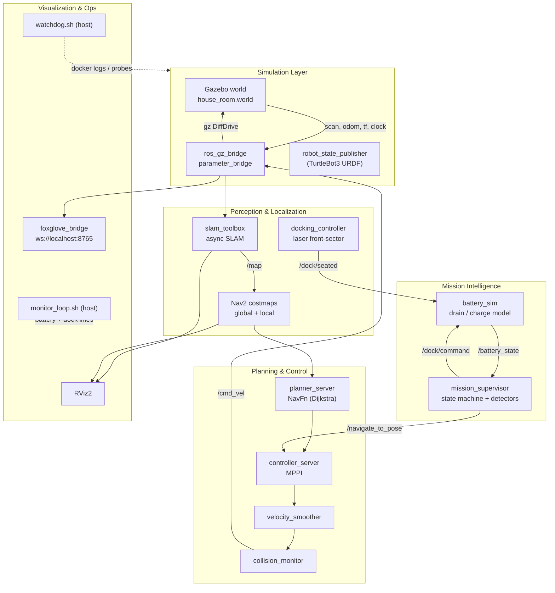
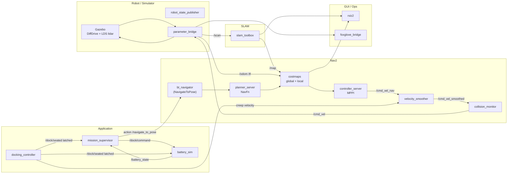
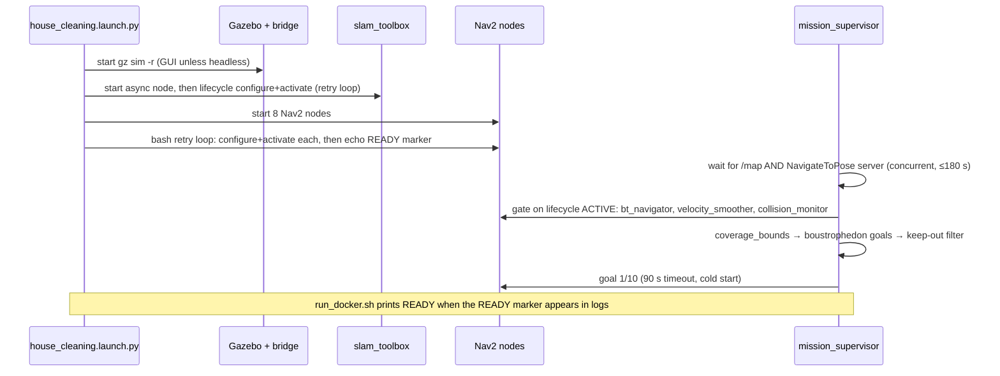
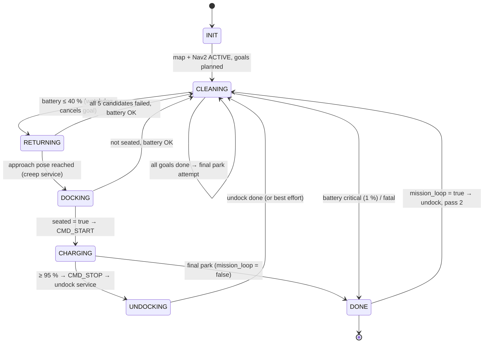
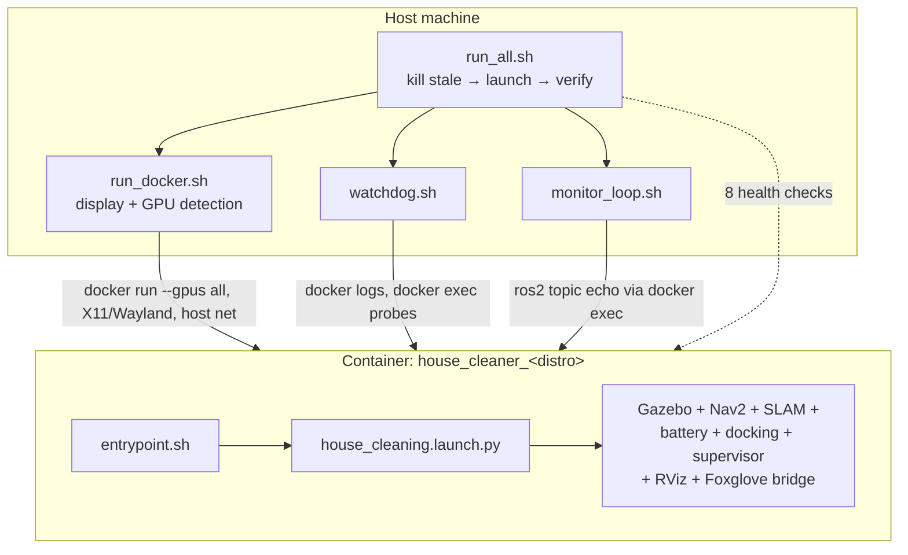

# House Cleaner Robot — Complete Project Documentation

> **Research-level reference manual** for the autonomous indoor cleaning robot
> simulation built on ROS 2 + Gazebo + Nav2.

| Item | Value | Item | Value |
| --- | --- | --- | --- |
| Project | House Cleaner Robot | Repository | `github.com/som-anshu/house_cleaner_ws` |
| Platform | ROS 2 (Lyrical / Jazzy / Humble) | Middleware | Fast DDS (`rmw_fastrtps`) |
| Simulator | Gazebo (Jetty 10 / Harmonic 8) | Robot | TurtleBot3 Burger (diff-drive) |
| Navigation | Nav2 (MPPI + NavFn) | SLAM | `slam_toolbox` (async, live mapping) |
| Languages | Python 3 (`rclpy`), Bash, CMake | License | MIT |
| Build | `colcon build --symlink-install` | Deployment | Docker (host network, GUI passthrough) |

**Abstract.** This project is a full autonomy stack that lets a low-cost
differential-drive robot sweep an *unknown* room: it builds the map with SLAM
while it works, plans a lawnmower-style coverage pattern from the live map,
navigates with Nav2, monitors its own battery, returns to a charging dock by
itself, seats with a laser-guided creep, recharges, undocks and resumes — in an
endless loop — all inside a Gazebo simulation with RViz/Foxglove GUIs and a
three-layer fault-recovery system (in-node watchdog, mission-level detectors,
host-level supervisor). The same launch file drives a real TurtleBot3 Burger,
because every subsystem talks only to shared topic/service/action contracts.

**Reading/format notes (A4).** All tables are capped at 4–5 narrow columns so
they print comfortably on A4 portrait. Diagrams are Mermaid (GitHub/renderer
syntax) with ASCII fallbacks where a flowchart is clearer. Pseudocode blocks
use plain English, not Python, so non-coders can follow the whole system.

---

## Table of Contents

1. [Aim & Objectives](#1-aim--objectives)
2. [System Overview & Technology Stack](#2-system-overview--technology-stack)
3. [Project Features](#3-project-features)
4. [File & Package Structure](#4-file--package-structure)
5. [Node Graph & Interface Contracts](#5-node-graph--interface-contracts)
6. [Launch System](#6-launch-system)
7. [Mission Lifecycle (State Machine)](#7-mission-lifecycle-state-machine)
8. [Key Algorithms](#8-key-algorithms)
9. [End-to-End Pseudocode for Non-Coders](#9-end-to-end-pseudocode-for-non-coders)
10. [Configuration Reference](#10-configuration-reference)
11. [Deployment, Monitoring & Fault Recovery](#11-deployment-monitoring--fault-recovery)
12. [How to Launch the Project](#12-how-to-launch-the-project)
13. [Testing & Validation](#13-testing--validation)
14. [Future Enhancements & Optimizations](#14-future-enhancements--optimizations)
15. [Glossary](#15-glossary)
16. [References](#16-references)

---

## 1. Aim & Objectives

### 1.1 Aim

To design and validate a **complete, fault-tolerant autonomous cleaning
mission** — map, clean, detect low battery, return, dock, charge, resume — in
simulation, with a GUI a human can watch end-to-end, and with the software
boundary clean enough that swapping the simulator for real hardware changes
only one launch argument (`mode:=real`).

### 1.2 Objectives

| # | Objective | How it is met |
| --- | --- | --- |
| 1 | Clean a room without a prebuilt map | Live `slam_toolbox` SLAM + coverage goals from the live `/map` |
| 2 | Full-coverage motion pattern | Boustrophedon (lawnmower) planner in `house_cleaner_core` |
| 3 | Safe navigation indoors | Nav2: NavFn planner + MPPI controller + costmaps |
| 4 | Energy awareness | Simulated battery with drain/charge model on `/battery_state` |
| 5 | Autonomous docking | Return waypoints → laser-guided creep service → seat → charge |
| 6 | Resume after charging | Undock service + mission loop (`mission_loop:=true`) |
| 7 | Survive real-world faults | 3 layers: node watchdog, mission detectors, host watchdog |
| 8 | One-command operation | `./run_all.sh` kills stale instances, launches, verifies |
| 9 | Portable across machines/distros | `ros-distro.sh` detection; Docker image built per distro |
| 10 | Watchable in a GUI | Gazebo GUI + RViz2 + Foxglove WebSocket bridge |

### 1.3 Success criteria

| Criterion | Target | Verified by |
| --- | --- | --- |
| Boot to ready | ≤ 180 s to Nav2 READY | `run_all.sh` health checks |
| Motion | Robot visibly drives, not stalled | `/cmd_vel` ≥ 20 Hz chain probe |
| Mission cycle | clean → return → dock → charge → undock → resume | `monitor_loop.sh` log |
| Stability | 0 watchdog FULL_RESTARTs during soak | `/tmp/opencode/watchdog.log` |
| Coverage | ≥ ~6 of 10 goals reached per pass | supervisor "COVERAGE COMPLETE" line |
| Health checks | 8/8 `[OK]` | `./run_all.sh --verify` |

---

## 2. System Overview & Technology Stack

### 2.1 High-level block diagram



### 2.2 Design principles

| Principle | Meaning in this codebase |
| --- | --- |
| Contract-driven | Nodes share only topics/services/actions, never imports of each other's code |
| Hardware-agnostic | Supervisor is unchanged between `battery_sim` and `battery_hw` |
| Portability | No hardcoded distro, user or path — everything from `ros-distro.sh` |
| Fail-fast, then skip | A bad coverage cell costs ≤ 45 s (or 15 s), never a stack hang |
| Safety last-gate | Every velocity (Nav2 *and* docking creep) passes the collision monitor |
| Observability | Every recovery logs a reason; three log files cover stack, watchdog, battery |

### 2.3 Technology stack

**Core platform**

| Layer | Technology | Role |
| --- | --- | --- |
| Middleware | ROS 2 + Fast DDS | Pub/sub, actions, services, TF |
| Client lib | `rclpy` (Python 3) | All custom nodes |
| Build | `colcon` + `ament` | `ament_python` nodes, `ament_cmake` msgs |
| Interfaces | `rosidl_generate_interfaces` | Custom msg/srv definitions |
| Lint | `ament_flake8` / `ruff`, `ament_uncrustify` | Style gates |

**Simulation**

| Technology | Role |
| --- | --- |
| Gazebo (gz-sim 10 Jetty / 8 Harmonic) | Physics, sensors, world |
| `ros_gz_sim` (`create`) | Spawns TurtleBot3 Burger SDF |
| `ros_gz_bridge` (`parameter_bridge`) | gz ↔ ROS topic translation |
| `turtlebot3_gazebo` / `turtlebot3_description` | Model, URDF, launch files |

**Navigation & mapping**

| Package | Role |
| --- | --- |
| `slam_toolbox` | Async graph-SLAM, live `/map` |
| `nav2_planner` (`NavfnPlanner`) | Global path (Dijkstra) |
| `nav2_controller` (`MPPIController`) | Local trajectory tracking |
| `nav2_bt_navigator` | NavigateToPose behavior tree |
| `nav2_behaviors` | spin / backup / drive_on_heading / wait |
| `nav2_velocity_smoother` | Accel/jerk-limited smoothing |
| `nav2_collision_monitor` | Polygon-based speed limiting (safety gate) |
| `nav2_waypoint_follower` | Waypoint utility (available, unused by mission) |
| `nav2_map_server`, `nav2_amcl` | Real-mode localization (`mode:=real`) |
| `nav2_lifecycle_manager` | Real-mode localization lifecycle only |

**Visualization & ops**

| Tool | Role |
| --- | --- |
| RViz2 | 3D view: map, scan, TF, paths, robot model |
| Foxglove bridge 3.6.x | WebSocket server on `ws://localhost:8765` |
| Foxglove Studio (web) | Browser UI at `https://app.foxglove.dev` |
| Docker / docker-compose | Containerized reproducible run |
| GNU Make | Thin wrappers over the shell scripts |

---

## 3. Project Features

| Category | Feature | Implemented in |
| --- | --- | --- |
| Mapping | Live SLAM, no prebuilt map needed | `slam_toolbox` + launch lifecycle retry |
| Coverage | Lawnmower path derived from live map window | `geometry.build_boustrophedon` |
| Coverage | Endpoints snapped to known-free cells | `geometry.snap_to_free_row` |
| Coverage | Furniture keep-out boxes (sofa/table/plant/crates/dock) | `in_furniture_keepout()` |
| Navigation | Global Dijkstra plan + MPPI rollout control | Nav2 `planner_server`, `controller_server` |
| Navigation | Smoothed, collision-gated velocity output | velocity smoother → collision monitor |
| Battery | Drain while moving, charge while docked, 0–100 % | `battery_sim` |
| Battery | Low-battery goal cancellation (0.5 s watchdog timer) | `mission_supervisor._watchdog_cb` |
| Docking | Return with 5 fallback approach poses | `_recharge_cycle()` |
| Docking | Laser-sector creep with stall/flat latches, 2 attempts | `docking_controller` |
| Docking | Verified undock (integrated-distance check) | `_undock_impl()` |
| Resilience | Node-level: VEL_STALL / NAV_SILENT / RETURN_BUDGET / BATTERY_EMPTY | `mission_supervisor` |
| Resilience | Host-level: log-silence, stuck-pattern, chain-hz probes | `watchdog.sh` |
| Resilience | Auto restart of the whole stack after 2 soft failures | `watchdog.sh` → `run_gui_loop.sh` |
| GUI | Gazebo GUI, RViz2, Foxglove browser view | launch + `foxglove_bridge` |
| Ops | One-command launch with stale kill + 8 health checks | `run_all.sh` |
| Sim/real | Same launch, `mode:=sim` / `mode:=real` | `house_cleaning.launch.py` |
| Loop mode | Restart coverage after final dock (endless demo) | `mission_loop:=true` |

---

## 4. File & Package Structure

### 4.1 Repository tree

```
house_cleaner_ws/
├── run_all.sh                 ← ONE command: kill stale → launch → verify
├── run_gui_loop.sh            ← GUI launch + watchdog + helper copy
├── run_docker.sh              ← Docker engine (display/GPU detection)
├── watchdog.sh                ← host stall watchdog (recover/restart)
├── monitor_loop.sh            ← battery/dock monitor loop
├── ros-distro.sh              ← distro/container-name detection (source me)
├── env.sh                     ← host ROS shell (source me)
├── Makefile                   ← launch/stop/verify/build wrappers
├── Dockerfile                 ← ros:<distro>-ros-base + Nav2 + GUI libs
├── entrypoint.sh              ← container entry (baked into image)
├── docker-compose.yml         ← alternative compose-based run
├── README.md  AGENTS.md  CONTEXT.md  PROJECT_PLAN.md  LICENSE
├── scripts/
│   ├── diag_stuck.py          ← samples full cmd_vel chain + plan
│   └── cancel_nav.py          ← cancels all active nav goals
└── src/
    ├── house_cleaner_msgs/        (ament_cmake, rosidl)
    │   ├── msg/DockCommand.msg  msg/DockState.msg
    │   └── srv/CreepToDock.srv
    ├── house_cleaner_core/        (ament_python, ROS-free)
    │   └── house_cleaner_core/geometry.py
    ├── house_cleaner_battery/     (ament_python)
    │   ├── house_cleaner_battery/battery_sim.py
    │   └── house_cleaner_battery/battery_hw.py
    ├── house_cleaner_docking/     (ament_python)
    │   └── house_cleaner_docking/docking_controller.py
    ├── house_cleaner_mission/     (ament_python)
    │   ├── house_cleaner_mission/mission_supervisor.py   (1193 lines)
    │   └── test/fake_sim.py        ← Gazebo-free robot stub
    └── house_cleaner_bringup/     (ament_cmake)
        ├── launch/  house_cleaning.launch.py   (main entry)
        │           gazebo_house_cleaning.launch.py
        │           rviz2.launch.py  foxglove_bridge.launch.py
        │           teleop.launch.py
        ├── config/  nav2_params.yaml  slam_toolbox_gazebo_params.yaml
        │           burger_bridge.yaml  house_cleaning.rviz
        │           foxglove_layout.json
        ├── worlds/  house_room.world
        ├── models/  wall/model.sdf
        └── scripts/ battery_monitor.py
```

> `build/`, `install/`, `log/` are generated by `colcon` and never edited.

### 4.2 Packages

| Package | Build type | Purpose | Executables |
| --- | --- | --- | --- |
| `house_cleaner_msgs` | ament_cmake | Custom dock interfaces | — (interfaces only) |
| `house_cleaner_core` | ament_python | Pure geometry + coverage planning | — (library) |
| `house_cleaner_battery` | ament_python | Battery + dock backend | `battery_sim`, `battery_hw` |
| `house_cleaner_docking` | ament_python | Creep/undock services | `docking_controller` |
| `house_cleaner_mission` | ament_python | Mission state machine | `mission_supervisor` |
| `house_cleaner_bringup` | ament_cmake | Launch, config, world, GUI | launch files, monitors |

### 4.3 Custom interfaces

| Interface | Kind | Fields (summary) | Direction |
| --- | --- | --- | --- |
| `DockCommand` | msg | `command` (START/STOP/FAULT), `current_limit` | supervisor → battery |
| `DockState` | msg | `seated`, `charging`, `state`, `current`, `voltage` | battery → others |
| `CreepToDock` | srv | req: empty; resp: `seated`, `front_clearance_m` | supervisor → docking |

### 4.4 Root scripts — purpose, inputs, outputs

| File | Purpose | Inputs | Outputs |
| --- | --- | --- | --- |
| `run_all.sh` | Kill stale → launch → verify, one command | flags `--stop`/`--verify` | READY report, 8 `[OK]` checks |
| `run_gui_loop.sh` | GUI mission-loop launch + watchdog start | `ros-distro.sh` env | container, watchdog PID |
| `run_docker.sh` | Container engine: display, GPU, build, READY wait | CLI flags, host display | running container + logs |
| `watchdog.sh` | Stall detection → soft recover → full restart | docker logs, topic hz probes | `/tmp/opencode/watchdog.log` |
| `monitor_loop.sh` | Battery/dock cycle observation | `/battery_state`, `/dock/state` | `/tmp/opencode/dockloop.txt` |
| `ros-distro.sh` | Detect distro, container/image names | `/opt/ros/*`, OS codename | `ROS_DISTRO`, `CONTAINER_NAME`… |
| `env.sh` | One-line host ROS environment | `ros-distro.sh`, `install/` | sourced shell env |
| `Makefile` | `launch/stop/verify/build/check` targets | — | wraps the scripts |
| `Dockerfile` | Image: ROS base + Nav2 + GUI libs | `ROS_DISTRO` build-arg | `house_cleaner:<distro>` image |
| `entrypoint.sh` | Source env, parse flags, `ros2 launch` | `--headless`, `--launch` | running launch process |
| `docker-compose.yml` | Compose alternative (host net, GPU) | env vars | service container |
| `scripts/diag_stuck.py` | Sample odom + 3 cmd_vel stages + plan | ROS topics (6 s window) | diagnostic dump to log |
| `scripts/cancel_nav.py` | Cancel every active nav goal | action servers | cancelled goals |

### 4.5 Source files — purpose, inputs, outputs

| File | Purpose | Inputs | Outputs |
| --- | --- | --- | --- |
| `mission_supervisor.py` | Full mission state machine + fault detectors | `/odom` `/scan` `/battery_state` `/map` `/global_costmap/costmap` `/dock/seated` `/cmd_vel_nav` `/cmd_vel` TF | goals to `/navigate_to_pose`, `/dock/command`, `/dock_pose`, state logs |
| `battery_sim.py` | Simulated battery + dock state machine | `/cmd_vel`, `/cmd_vel_smoothed`, `/odom`, `/dock/command`, `/dock/seated` | `/battery_state` (0–1), `/dock/state` |
| `battery_hw.py` | Real-hardware battery + dock wrapper | OpenCR BMS topic, seat/charge GPIO topics | same `/battery_state`, `/dock/state` contract |
| `docking_controller.py` | Creep & undock services | `/scan`, `/odom` | velocity on `/cmd_vel_nav`, `/dock/seated` (latched) |
| `geometry.py` | ROS-free math: quaternions, coverage, snapping | grids as plain data | goals, bounds, blocked reasons |
| `mission_supervisor` (test) `fake_sim.py` | Gazebo-free stub robot for unit tests | `/cmd_vel` | fake `/odom` `/scan` `/tf` |
| `battery_monitor.py` | ASCII battery gauge for a terminal | `/battery_state` | 1 Hz console render |

### 4.6 Launch & config files — purpose, inputs, outputs

| File | Purpose | Inputs | Outputs |
| --- | --- | --- | --- |
| `house_cleaning.launch.py` | Starts the entire stack (sim or real) | args: `mode`, `headless`, `gui`, rates, dock pose | ~20 nodes + lifecycle bringup |
| `gazebo_house_cleaning.launch.py` | Gazebo + URDF + spawn + bridge | `world`, `headless`, poses | gz server(/GUI), `/scan` `/odom` `/tf` `/clock` |
| `rviz2.launch.py` | Standalone RViz with project config | `house_cleaning.rviz` | RViz window |
| `foxglove_bridge.launch.py` | Standalone Foxglove bridge | port 8765 | WebSocket endpoint |
| `teleop.launch.py` | Keyboard teleop (xterm) | keystrokes | `/cmd_vel` |
| `nav2_params.yaml` | Every Nav2 tuning value | — | controller/planner/costmap behaviour |
| `slam_toolbox_gazebo_params.yaml` | SLAM tuning | — | map resolution, update triggers |
| `burger_bridge.yaml` | gz ↔ ROS topic map (plain `Twist`) | — | bridge routing table |
| `house_cleaning.rviz` | RViz display layout | topics | GUI panels |
| `foxglove_layout.json` | Foxglove panel layout | — | browser UI layout |
| `house_room.world` | 4.65 × 5.75 m room, furniture, dock | — | simulated world |

---

## 5. Node Graph & Interface Contracts

### 5.1 Node inventory (sim mode, `mode:=sim gui:=true`)

| Node | Executable / process | Package | Role |
| --- | --- | --- | --- |
| Gazebo | `gz sim -r house_room.world` | ros_gz_sim | Physics + sensors |
| `parameter_bridge` | `ros_gz_bridge` | ros_gz_bridge | gz ↔ ROS topics |
| `robot_state_publisher` | turtlebot3 launch | turtlebot3 | URDF → TF |
| `slam_toolbox` | `async_slam_toolbox_node` | slam_toolbox | Live map + `map→odom` |
| `planner_server` | Nav2 | nav2_planner | Global path |
| `controller_server` | Nav2 | nav2_controller | MPPI path tracking |
| `behavior_server` | Nav2 | nav2_behaviors | Recovery behaviors |
| `bt_navigator` | Nav2 | nav2_bt_navigator | NavigateToPose action |
| `smoother_server` | Nav2 | nav2_smoother | Path smoothing |
| `waypoint_follower` | Nav2 | nav2_waypoint_follower | Waypoint utility |
| `velocity_smoother` | Nav2 | nav2_velocity_smoother | Accel-limited output |
| `collision_monitor` | Nav2 | nav2_collision_monitor | Safety gate → `/cmd_vel` |
| `battery` | `battery_sim` (sim) / `battery_hw` (real) | house_cleaner_battery | Battery + dock state |
| `docking_controller` | `docking_controller` | house_cleaner_docking | Creep / undock services |
| `mission_supervisor` | `mission_supervisor` | house_cleaner_mission | Mission brain |
| `rviz2` | separate process | rviz2 | 3D view |
| `foxglove_bridge` | WebSocket server | foxglove_bridge | Browser view |

*Real mode (`mode:=real`) adds `map_server` + `amcl` and drops `slam_toolbox`,
Gazebo and the bridge.*

### 5.2 Node graph



### 5.3 Topic contracts

**Data plane (simulator ↔ stack)**

| Topic | Type | Publisher | Subscriber(s) |
| --- | --- | --- | --- |
| `/clock` | `rosgraph_msgs/Clock` | bridge (gz) | all nodes (`use_sim_time`) |
| `/scan` | `sensor_msgs/LaserScan` | bridge | slam, costmaps, docking, supervisor |
| `/odom` | `nav_msgs/Odometry` | bridge | costmaps, battery, docking, supervisor |
| `/tf` | `tf2_msgs/TFMessage` | bridge, slam, RSP | everyone |
| `/imu`, `/joint_states` | Imu, JointState | bridge | (model state) |
| `/cmd_vel` | `geometry_msgs/Twist` | **collision_monitor** | bridge → gz DiffDrive |
| `/map` | `nav_msgs/OccupancyGrid` | slam_toolbox | supervisor, RViz, global costmap |

**Velocity chain (the most safety-critical path)**

| Stage | In → Out topic | Node | Rate |
| --- | --- | --- | --- |
| 1 | intent → `/cmd_vel_nav` | controller_server / behavior_server / docking | 20 Hz |
| 2 | `/cmd_vel_nav` → `/cmd_vel_smoothed` | velocity_smoother | 20 Hz |
| 3 | `/cmd_vel_smoothed` → `/cmd_vel` | collision_monitor | 20 Hz |
| 4 | `/cmd_vel` → gz `cmd_vel` | parameter_bridge | on change |

> All four stages run with `enable_stamped_cmd_vel: false` (plain `Twist`).
> Mixing `TwistStamped` into this chain is the single most common failure mode
> on newer distros — the robot simply never moves.

**Mission plane**

| Topic | Type | Publisher | Subscriber(s) |
| --- | --- | --- | --- |
| `/battery_state` | `sensor_msgs/BatteryState` (0–1) | battery | supervisor, monitor, watchdog |
| `/dock/command` | `house_cleaner_msgs/DockCommand` | supervisor | battery |
| `/dock/state` | `house_cleaner_msgs/DockState` | battery | monitor |
| `/dock/seated` | `std_msgs/Bool` (TRANSIENT_LOCAL) | docking ctrl | battery, supervisor |
| `/dock_pose` | `geometry_msgs/PoseStamped` | supervisor | RViz/debug |
| `/cmd_vel_nav`, `/cmd_vel` | `Twist` | chain stages | supervisor (stall detectors) |
| `/global_costmap/costmap` | `OccupancyGrid` | Nav2 | supervisor (goal revalidation) |
| `/plan` | `nav_msgs/Path` | planner_server | RViz, diag tools |

**Actions & services**

| Name | Interface | Client | Server |
| --- | --- | --- | --- |
| `/navigate_to_pose` | `nav2_msgs/NavigateToPose` action | supervisor | bt_navigator |
| `/creep_to_dock` | `house_cleaner_msgs/CreepToDock` | supervisor | docking_controller |
| `/undock` | `std_srvs/Trigger` | supervisor | docking_controller |
| `/<node>/get_state` | `lifecycle_msgs/GetState` | supervisor (gate) | Nav2 lifecycle nodes |

### 5.4 TF tree

```
map ──(slam_toolbox, ~50 Hz)──► odom ──(gz DiffDrive via bridge)──► base_footprint
                                                                        │
                                                                        ├──► base_link ──► base_scan (lidar)
                                                                        └──► wheels / sensors (URDF from RSP)
```

Frames used by name: `map`, `odom`, `base_footprint`, `base_scan`. The
supervisor looks up `map → base_footprint` for its ground-truth pose.

### 5.5 Boot sequence



**Why the gate matters:** the action server advertises before the node is
ACTIVE, and `velocity_smoother`/`collision_monitor` activate *last*. A goal
sent in that window commands motion over a dead `/cmd_vel` chain, which looks
like a stall and used to feed a restart loop. The supervisor therefore waits
for all three lifecycle nodes to report state `ACTIVE (id=3)`.

---

## 6. Launch System

### 6.1 Launch files

| Launch file | Called by | Starts |
| --- | --- | --- |
| `house_cleaning.launch.py` | entrypoint, `run_docker.sh --launch` | whole stack (includes the two below) |
| `gazebo_house_cleaning.launch.py` | included when `mode:=sim` | gz server/GUI, RSP, spawn, bridge |
| `rviz2.launch.py` | standalone | RViz only |
| `foxglove_bridge.launch.py` | standalone | Foxglove bridge only |
| `teleop.launch.py` | standalone | keyboard teleop in xterm |

### 6.2 Main launch arguments

| Argument | Default | Effect |
| --- | --- | --- |
| `mode` | `sim` | `sim`: Gazebo+SLAM+`battery_sim`; `real`: AMCL+`battery_hw` |
| `use_sim_time` | `true` | All nodes follow `/clock` |
| `headless` | `false` | Gazebo server-only (no GUI window) |
| `gui` | `true` | Start RViz2 + Foxglove bridge |
| `mission_loop` | `false` | After final dock, undock and clean again |
| `battery_drain_rate` | `0.20` | %/s discharge while moving |
| `battery_charge_rate` | `0.80` | %/s charge while seated |
| `battery_low_threshold` | `40.0` | % triggering return-to-dock |
| `battery_charge_target` | `95.0` | % at which cleaning resumes |
| `mission_strip_width` | `0.45` | Coverage strip spacing (m) |
| `mission_return_budget` | `180.0` | Wall-clock s for whole RETURNING phase |
| `dock_x/y/yaw` | `0.0 / 2.75 / 90°` | Dock pose in map frame |
| `map` | `''` | Map YAML for `mode:=real` |

### 6.3 Lifecycle bringup (why not `nav2_lifecycle_manager`)

Nav2 and SLAM are brought up by **bash retry loops** generated inside the
launch file: up to 120 × 1 s retries per `configure`, then per `activate`,
ending with the marker line `Nav2 lifecycle bringup complete`.

| Approach | Behaviour under cold-boot load | Used here? |
| --- | --- | --- |
| `nav2_lifecycle_manager` | 2 s `get_state` timeout → aborts whole bringup | No (nav) |
| bash retry loop | busy executor only *delays*, never aborts | **Yes** |
| Direct `ros2 lifecycle set` | works for slam_toolbox (no Bond server) | **Yes** (SLAM) |

---

## 7. Mission Lifecycle (State Machine)

### 7.1 State diagram



### 7.2 States in words

| State | What the robot does | Exit condition |
| --- | --- | --- |
| `INIT` | Wait for `/map`, action server, lifecycle ACTIVE | all ready ≤ 180 s |
| `CLEANING` | Drive the boustrophedon goal list, one by one | list done, or battery ≤ 40 % |
| `RETURNING` | Try 5 dock-approach poses within a 180 s budget | reach approach, or budget/empty |
| `DOCKING` | Laser creep forward until seated (≤ 2 attempts) | `seated=true` |
| `CHARGING` | Sit at dock, wait for 95 % (cap 300 s) | ≥ 95 % or dock lost |
| `UNDOCKING` | Back out 0.48 m, verify motion | success/failure logged |
| `DONE` | Parked (or halted); loop mode restarts pass | — |

### 7.3 Goal-result policy (the "what if" table)

| Supervisor status | Meaning | Action taken |
| --- | --- | --- |
| `SUCCEEDED` | Reached within 0.30 m / 0.30 rad | Advance to next goal |
| `ABORTED` (err 102) | TF lag (transient) | Settle 3 s, retry once |
| `ABORTED` (other) | Planner cannot reach cell | Skip immediately |
| `TIMEOUT` | 45 s (or 90 s first/returning) expired | Revalidate, retry once, then skip |
| `NAV_SILENT` | MPPI alive but zero output ≥ 15 s | Skip immediately (deterministic freeze) |
| `VEL_STALL` | `/cmd_vel` silent ≥ 8 s while nav commands | Settle, one retry, then skip |
| `RETURN_BUDGET` | Return phase exceeded 180 s | Stop return attempts |
| `BATTERY_EMPTY` | ≤ 1 % and not seated | Abort mission this cycle |
| `CANCELED` | Low-battery watchdog cancelled it | Re-enter loop → recharge cycle |

### 7.4 Return-to-dock approach candidates

The map is SLAM-built and drifts, so a single fixed waypoint occasionally
lands in a phantom cell. The supervisor walks five poses (creep is laser
guided, so any pose in front of the dock works):

| # | Pose (x, y, yaw) | Rationale |
| --- | --- | --- |
| 1 | `0.00, 1.87, 90°` | Canonical: 0.88 m south of dock |
| 2 | `0.00, 2.17, 90°` | Closer (approach − 0.30) |
| 3 | `−0.30, 1.87, 90°` | Lateral left (map drift) |
| 4 | `+0.30, 1.87, 90°` | Lateral right |
| 5 | `0.00, 1.47, 90°` | Further back (worst case) |

---

## 8. Key Algorithms

### 8.1 Boustrophedon coverage planning

**Idea.** Classic *boustrophedon* ("as the ox turns") cellular decomposition:
sweep the free rectangle in parallel strips, alternating direction — the
robot's path resembles a lawnmower. Here each row contributes its **two
endpoints** as navigation goals; Nav2 drives the straight segment between
them, so the strip of width `strip` is covered as the robot passes.

**Inputs:** live SLAM grid → `coverage_bounds(margin=0.55)` (map window
inset by 0.55 m to stay out of the inflation band) → goal list.

```text
FUNCTION build_boustrophedon(bounds, strip, grid):
    shrink bounds by strip/2 on every side          # keep goals inside map
    y ← y_min + strip/2 ;  row ← 0
    WHILE y ≤ y_max − strip/2:
        IF row is even:  endpoints ← (x_min, yaw=0), (x_max, yaw=π)
        ELSE:            endpoints ← (x_max, yaw=π), (x_min, yaw=0)
        FOR each (x, yaw) in endpoints:
            IF grid given:
                x ← snap_to_free_row(grid, x, y)     # nearest free cell
                IF none found on this row: CONTINUE  # row fully blocked
            APPEND goal (x, y, yaw)
        y ← y + strip ;  row ← row + 1
    RETURN goals
```

**Why even/odd yaw alternates:** the robot ends each row facing the travel
direction, so it does not waste time (or battery) turning 180° in place.

### 8.2 Goal revalidation & the keep-out filter

Maps mature while cleaning, so a goal planned at t=0 may be invalid at t=60 s.
Two guards run **before every goal**:

**A — static keep-out.** Known furniture footprints (AABB inflated by
0.32 m, plant 0.50 m) plus the dock body are rejected outright:

```text
FUNCTION in_furniture_keepout(x, y):
    FOR each furniture box (sofa, table, plant, crates, dock):
        c ← per-box clearance
        IF x,y inside box inflated by c: RETURN TRUE
    RETURN FALSE
```

**B — live revalidation.** The goal is re-read from the newest global
costmap (preferred) or SLAM grid; if blocked, sweep ±2 m **along the same
row** for an unblocked cell; if the whole row is blocked, drop the goal:

```text
FUNCTION revalidate_goal(grid, x, y, blocked):
    IF NOT blocked(x, y): RETURN (x, y, OK)
    FOR step = 1 … 2.0 m in resolution steps:
        FOR cx in (x + step, x − step):
            IF grid cell (cx, y) exists AND NOT blocked(cx, y):
                RETURN (cx, y, OK)                 # re-snapped
    RETURN (x, y, "row blocked")                   # caller skips goal
```

**Blocked predicate** (on the 0–100 occupancy scale): unknown (−1) or ≥ 50 →
blocked; unknown space is *never* a cleaning goal.

### 8.3 Global planning — NavFn (Dijkstra)

| Parameter | Value | Why |
| --- | --- | --- |
| `plugin` | `nav2_navfn_planner::NavfnPlanner` | Classic grid shortest path |
| `use_astar` | `false` | Dijkstra gives smoother, less greedy paths |
| `allow_unknown` | `true` | Early SLAM map is mostly unknown |
| `tolerance` | `0.30` | Goal snapped to nearest free cell — must stay ≤ the goal-checker xy tolerance (0.30) or the robot could never "arrive" |

NavFn expands cells by cost (inflation layer: radius 0.30 m,
`cost_scaling_factor` 2.5) from start to goal and back-tracks the cheapest
path; the `smoother_server` (SimpleSmoother, 1000 iterations) then removes
grid kinks before MPPI tracks it.

### 8.4 Local control — MPPI (Model Predictive Path Integral)

**Idea.** MPPI is a sampling-based stochastic optimal controller: at every
control cycle it samples hundreds of noisy velocity rollouts over a short
horizon, scores each with a weighted sum of *critics*, and averages the best
samples into the command actually sent. No explicit obstacle "planner" —
obstacle avoidance falls out of the cost function.

```text
FUNCTION mppi_control_cycle(state, reference_path):
    noises ← sample batch_size noisy (v, w) sequences of time_steps
    FOR each sampled rollout:
        simulate robot forward model_dt × time_steps (diff-drive)
        cost ← Σ critics(rollout, path, costmap)        # see table
    weights ← exp(−cost / temperature)   normalised, scaled by gamma
    command ← Σ (weights × sampled controls)            # noise-averaged output
    RETURN command
```

| Parameter | Value | Meaning |
| --- | --- | --- |
| `batch_size` | 600 | rollouts per cycle |
| `time_steps` × `model_dt` | 56 × 0.05 s | 2.8 s prediction horizon |
| `temperature`, `gamma` | 0.5, 0.015 | exploration vs. exploitation |
| `vx` range | −0.40 … 0.65 m/s | reverse allowed (needed in corners) |
| `wz` max | 2.5 rad/s | in-place turn authority |
| `controller_frequency` | 20 Hz | cycle rate |

| Critic | Weight | Purpose |
| --- | --- | --- |
| `PathAlignCritic` | 14.0 | Stay aligned with the global path |
| `PathFollowCritic` | 7.0 | Keep progressing along the path |
| `GoalCritic` | 5.0 | Pull toward the goal (radius 1.4 m) |
| `ConstraintCritic` | 4.0 | Respect velocity/accel limits |
| `GoalAngleCritic` | 3.0 | Final heading (radius 0.5 m) |
| `PathAngleCritic` | 2.0 | Path tangent direction |
| `CostCritic` | 3.5 | Collision cost (critical 300, collision 1e6) |
| `PreferForwardCritic` | **0.0** | Reverse is free — escape furniture corners |

Known behaviour: near a goal the cost gradient can vanish and MPPI stops
~0.28 m short — hence `xy_goal_tolerance: 0.30` and the `NAV_SILENT` detector
(§8.9) that skips deterministic freeze cells after 15 s.

### 8.5 Goal & progress checkers

| Checker | Rule | Tuned value |
| --- | --- | --- |
| `SimpleGoalChecker` | Success if ‖p − goal‖ ≤ tol **and** yaw error ≤ tol | `0.30 m`, `0.30 rad` |
| `SimpleProgressChecker` | Abort if moved < 0.05 m in allowance | `90 s` allowance |
| `failure_tolerance` | Tolerate costmap/TF hiccups before abort | `2.0 s` |

### 8.6 SLAM — scan matching with movement gating

`slam_toolbox` (async, 0.05 m resolution) matches each new scan against the
map, but only *when the robot has actually moved* — otherwise drift-free
in-place rotations are skipped:

| Parameter | Value | Why it matters here |
| --- | --- | --- |
| `minimum_travel_distance` | 0.15 m | Must stay **below the 0.48 m undock** move, else `map→odom` stays stale after undock and the planner sees the robot *inside* the dock (lethal cells) → "Failed to create plan" |
| `minimum_travel_heading` | 0.20 rad | Same for pure rotations |
| `map_update_interval` | 5.0 s | Map republish cadence |
| `max_laser_range` | 4.0 m | Slightly above physical 3.5 m (no clipping) |

### 8.7 Laser-guided docking creep

**Idea.** Nav2 gets the robot to an approach pose ~0.88 m in front of the
dock; the last decimetres are done open-loop-free by *reading the lidar*: drive
forward slowly until the front sector sees the dock face close enough.

```text
FUNCTION creep_to_dock_once():
    clear 3-second clearance window
    FOR up to creep.timeout (30 s), every 50 ms:
        fwd ← min laser range within ±12° of straight ahead
        IF no scan:            STOP and wait           # never creep blind
        IF fwd < 0.13 m:       RETURN SEATED           # docked
        IF fwd < 0.35 m AND robot speed < 0.01 for 2.5 s:
                               RETURN SEATED           # stall-latch (pressed)
        IF ≥ 6 samples within 3 s all inside 0.35 m
           AND spread < 0.05 m: RETURN SEATED          # flat-clearance window
        speed ← (fwd > 0.20) ? 0.04 : max(0, fwd − 0.10)   # creep slows near dock
        PUBLISH forward speed
    STOP
    RETURN SEATED IF fwd < 0.35 else FAILED            # "pressed" on timeout
```

*Service wrapper:* up to `max_attempts = 2` passes; between attempts it
backs out and re-approaches. Every velocity it publishes goes into
`/cmd_vel_nav`, so the **collision monitor remains the last-resort bumper**
even during docking (its front polygon limits speed to 45 % inside 0.35 m).

### 8.8 Undock

```text
FUNCTION undock():
    integrated ← 0
    FOR (0.48 / 0.06 + 1) seconds:        # ~9 s at −0.06 m/s
        PUBLISH reverse velocity
        integrated ← integrated + |odom speed| × 0.05
    STOP
    RETURN integrated ≥ 0.24 m            # half the commanded distance
```

Failure is *reported*, never faked: if the robot did not move, `/dock/seated`
stays `true`, so the battery cannot start "charging" in free space.

### 8.9 Mission-level fault detectors (the supervisor's nervous system)

Checked every 100 ms while a goal is in flight (plus a 0.5 s watchdog timer):

| Detector | Condition | Response |
| --- | --- | --- |
| `BATTERY_EMPTY` | ≤ 1 % and not seated | Cancel goal, halt mission cycle |
| `RETURN_BUDGET` | monotonic time > 180 s since RETURNING started | Cancel goal, stop approach attempts |
| `VEL_STALL` | `/cmd_vel_nav` fresh **and** wants v ≥ 0.02 **and** `/cmd_vel` silent > 8 s **and** robot still | Cancel goal → settle → one retry → skip |
| `NAV_SILENT` | controller alive but v,w < 0.02 for ≥ 15 s while robot still | Cancel → skip immediately (~20 s vs 90 s) |
| Low battery | ≤ 40 % while CLEANING | Cancel goal → `_recharge_cycle()` |

**Why 8 s / 15 s hysteresis:** host load causes multi-second scheduling
blips; tighter thresholds (2 s) cancelled healthy goals and fed restart loops.

### 8.10 Safety chain — smoother + collision monitor

| Component | Setting | Effect |
| --- | --- | --- |
| velocity_smoother | OPEN_LOOP, `max_vel 0.65/2.5`, accel 1.5, decel −2.0, jerk 3.0, 20 Hz | Gentle, predictable motion |
| collision_monitor `PolygonSlow` | front quad (0.12–0.35 m, ±0.15 m), **limit 45 %** | Slow near obstacles instead of stopping |
| `source_timeout` | 3.0 s | Survives gz-bridge gaps under load |
| *No* `PolygonStop` | — | A stop polygon deadlocks: obstacle stays in polygon → monitor stops publishing → `/cmd_vel` silent forever → false VEL_STALL |

### 8.11 Battery model

```text
EVERY 0.2 s:
    read live drain_rate / charge_rate parameters (hot-tunable)
    IF seated AND charging AND pct < 100:  pct ← pct + charge_rate × 0.2
    ELSE IF NOT docked AND speed > 0.03:   pct ← pct − drain_rate  × 0.2
    IF pct ≤ 0 AND NOT docked: latch "empty" once (logged as an error)
    PUBLISH /battery_state   (percentage = pct/100, voltage = 10.0 … 12.6 V lerp)
    PUBLISH /dock/state      (seated, charging, state, current)
```

Speed comes from `/odom` (ground truth, always present) with `/cmd_vel*` as
redundant sources — so drain works even while the velocity chain is being
restarted.

### 8.12 Host watchdog (`watchdog.sh`)

```text
EVERY 15 s:
    IF container gone:            FULL_RESTART (run_gui_loop.sh)
    reason ← empty
    IF no mission log line for 180 s:                 reason ← LOG_SILENCE
    IF ≥4 stall lines in 100 s AND 0 progress in 240 s: reason ← STUCK_PATTERN
    IF battery ~0 % AND not seated:                   reason ← BATTERY_EMPTY
    IF /cmd_vel_nav ≥ 2 Hz AND /cmd_vel < 1 Hz twice:  reason ← VEL_CHAIN
    IF reason:
        SOFT RECOVER: dump diagnostics, cancel nav goals,
                      bounce velocity_smoother + collision_monitor
        IF 2 soft recoveries in a row: FULL_RESTART of the stack
```

Debouncing rules that made it safe: the chain probe must hit **twice** in a
row; the stuck-pattern probe ignores any window with fresh
`Reached the goal! / DOCKED / CHARGED` markers; healthy chatter resets the
soft-recovery budget.

---

## 9. End-to-End Pseudocode for Non-Coders

> Written in plain English, step by step — no programming knowledge needed.
> Each "ACT" maps to real code in `mission_supervisor.py` / the launch stack.

### ACT 0 — Wake up (launch, ~90–180 s)

```text
START everything at once:
  • Gazebo opens the house world and starts physics
  • A "translator" connects Gazebo's topics to ROS topics
  • SLAM starts and begins building a map from the laser scanner
  • 8 navigation programs start and switch themselves ON one by one
    (each is retried for up to 2 minutes if the machine is busy)
  • When all are ON, the log prints: "Nav2 lifecycle bringup complete"

THE SUPERVISOR (the robot's brain) then waits, in parallel, for:
  • a map to arrive, and
  • the "drive to pose" service to accept jobs
and additionally CHECKS that three safety-critical programs are truly ACTIVE
(the motion smoother and the collision monitor switch on last — starting a
job before they are ready looks like a dead robot).
```

### ACT 1 — Plan the cleaning route

```text
TAKE the current map window (the rectangle SLAM has learned so far)
SHRINK it by 0.55 m on each side   → robot never hugs walls/furniture
SHRINK by half a strip (0.225 m)   → goals stay inside the map

LAY strips 0.45 m apart, north to south:
    strip 1: go west-end → east-end
    strip 2: go east-end → west-end
    strip 3: west → east ... alternating like a lawnmower
each strip's two ENDS become navigation goals

FOR every goal:
    if it lies inside a known piece of furniture (sofa, table, plant,
    crates, dock) → throw it away
    if the map says the cell is unknown or occupied → slide it sideways
    along its strip (up to 2 m) until it sits on free floor
    if the whole strip is blocked → skip that goal

RESULT: an ordered list like "goal 1/10 … goal 10/10".
```

### ACT 2 — Clean (the main loop)

```text
REPEAT until the list is finished:

    1. If battery ≤ 40 % → go to ACT 3 (recharge) first.

    2. Before sending each goal, RE-CHECK it against the newest costmap:
       the map has changed while we were driving. If it became blocked,
       re-slide it; if hopeless, skip it.

    3. SEND "drive to (x, y, facing)" to Nav2.
       While waiting, watch four alarm clocks (each cancels the job):
         • battery died (≤ 1 %)          → abort everything
         • returning took > 180 s        → stop trying to dock
         • controller asks to move but
           no motion commands come out
           for 8 s while robot is still  → chain broken: retry once, skip
         • controller is alive but commands
           NOTHING for 15 s while still  → stuck cell: skip at once
       Normal goals finish in 4–13 s. First goal and dock goals get 90 s
       (the map/TF are still warming up); ordinary goals get only 45 s so a
       bad cell fails fast instead of freezing the pass.

    4. RESULT HANDLING:
         SUCCEEDED   → advance to next goal
         ABORTED     → skip (planner proved the cell unreachable)
         TIMEOUT     → re-check, try ONE more time, then skip
         CANCELED    → battery low, loop around to ACT 3
```

### ACT 3 — Return, dock, charge

```text
STATE "RETURNING", start a 180-second wall-clock budget.

TRY up to 5 approach poses in front of the dock (the SLAM map drifts, so if
one pose lands in a phantom obstacle, the next one probably works):
    canonical 0.88 m south of dock, then closer, left, right, further back.

IF an approach pose reached:
    CALL the creep service (ACT 4)
ELSE (budget out / battery dead):
    give up docking gracefully — cleaning may resume if battery is fine.

IF seated:
    tell the battery backend "start charging"
    WAIT until 95 % (max 300 s, and abort early if the robot leaves the dock)
    tell it "stop charging"
    IF this was the final park: STAY (or undock for the next pass in loop mode)
    ELSE: call the undock service, then resume ACT 2
```

### ACT 4 — The last 15 centimetres (docking creep)

```text
DRIVE forward at 0.04 m/s, reading ONLY the laser:
    front clearance < 0.13 m           → SEATED, stop
    pressed against dock (speed ≈ 0
      while clearance < 0.35 m, 2.5 s) → SEATED (stall latch)
    steady readings for 3 s            → SEATED (flat-surface latch)
    no laser at all                    → STOP (never creep blind)
    slow down automatically as the dock gets close
    30 s without success               → this pass failed
Service retries: up to 2 attempts, backing out between them.
Its velocity travels through the SAME smoothing + collision-gate chain as
Nav2, so the safety polygon acts as a bumper during docking too.
On success it latches /dock/seated = true — a latched topic, so late
subscribers still learn the state.

UNDOCK: reverse at 0.06 m/s for ~9 s, then PROVE we moved by integrating
odometer distance (must be ≥ half of 0.48 m). If not, report failure and
keep /dock/seated = true — never fake success.
```

### ACT 5 — Watchdogs (three layers of bodyguards)

```text
LAYER 1 — inside the supervisor (every 0.5 s while a goal flies):
    cancel the goal on low battery / empty battery / dead chain / budget

LAYER 2 — the supervisor's detectors while waiting for a goal result:
    VEL_STALL, NAV_SILENT, RETURN_BUDGET, BATTERY_EMPTY (see §8.9)

LAYER 3 — on the HOST computer (every 15 s):
    container died            → relaunch everything
    no logs for 180 s         → soft recovery
    ≥4 stall lines & no progress → soft recovery
    battery empty not seated  → soft recovery
    cmd_vel dead, cmd_vel_nav alive (twice) → soft recovery
    soft recovery = dump diagnostics + cancel goals + restart
                    the two velocity-chain nodes
    2 soft recoveries in a row → full restart of the whole stack
```

### ACT 6 — Observation (the human-facing part)

```text
Gazebo GUI        → watch the robot physically move
RViz              → map, laser, costmaps, planned path, robot model
Foxglove (browser)→ same data over WebSocket at ws://localhost:8765
watchdog log      → /tmp/opencode/watchdog.log
battery/dock log  → /tmp/opencode/dockloop.txt (20 s samples, looped)
container logs    → docker logs -f house_cleaner_<distro>
```

---

## 10. Configuration Reference

### 10.1 Mission / battery / dock (supervisor + battery node)

| Parameter | Default | Meaning |
| --- | --- | --- |
| `battery.low_threshold` | 40 % | Return-to-dock trigger |
| `battery.critical` | 1 % | Hard mission abort |
| `battery.charge_target` | 95 % | Resume cleaning |
| `mission.strip_width` | 0.45 m | Coverage strip spacing |
| `mission.max_goals` | 0 (all) | Limit goals (debugging) |
| `mission.loop` | false | Restart coverage after final dock |
| `mission.return_budget` | 180 s | Whole RETURNING nav phase |
| `mission.stall_hold` | 8.0 s | `/cmd_vel` silence before VEL_STALL |
| `dock.x / y / yaw` | 0.0 / 2.75 / 90° | Dock pose |
| `dock.approach_back` | 0.88 m | Approach distance south of dock |
| `drain_rate` | 0.20 %/s | Hot-tunable (`ros2 param set`) |
| `charge_rate` | 0.80 %/s | Hot-tunable |

### 10.2 Docking controller

| Parameter | Default | Meaning |
| --- | --- | --- |
| `creep.speed` | 0.04 m/s | Creep command speed |
| `creep.stop_range` | 0.13 m | "Seated" clearance |
| `creep.timeout` | 30 s | Per-pass creep limit |
| `creep.sector_deg` | 12° | Front laser sector half-angle |
| `creep.max_attempts` | 2 | Service retries |
| `undock.speed` | −0.06 m/s | Reverse speed |
| `undock.meters` | 0.48 m | Undock distance (≥ SLAM travel gate) |
| `velocity_topic` | `/cmd_vel_nav` | Wired by launch into the safety chain |

### 10.3 Nav2 highlights (`nav2_params.yaml`, 447 lines)

| Area | Key values |
| --- | --- |
| Controller | MPPI, 20 Hz, `vx −0.4…0.65`, `wz 2.5`, batch 600, horizon 56×0.05 s |
| Goal check | `xy 0.30`, `yaw 0.30` |
| Progress check | 0.05 m in 90 s |
| Planner | NavFn Dijkstra, `tolerance 0.30`, `allow_unknown true` |
| Costmaps | radius 0.105 m, inflation 0.30 m, scale 2.5; local `track_unknown_space: false` |
| Smoother | OPEN_LOOP, accel 1.5, decel −2.0, jerk 3.0, timeout 0.5 s |
| Collision monitor | `PolygonSlow` 45 %, `source_timeout 3.0 s`, no stop polygon |
| BT | `default_server_timeout 5000 ms` (was 20 ms → spurious aborts) |
| Stamped vel | `enable_stamped_cmd_vel: false` on controller + behavior + smoother + monitor |

### 10.4 SLAM (`slam_toolbox_gazebo_params.yaml`)

| Parameter | Value | Note |
| --- | --- | --- |
| mode | mapping | Live SLAM (real mode uses AMCL instead) |
| resolution | 0.05 m | Map cell size |
| minimum_travel_distance | 0.15 m | < 0.48 m undock, deliberately |
| minimum_travel_heading | 0.20 rad | Scan-match trigger |
| map_update_interval | 5.0 s | Republish cadence |
| max_laser_range | 4.0 m | Physical lidar is 3.5 m |

---

## 11. Deployment, Monitoring & Fault Recovery

### 11.1 Docker architecture



| Fact | Value |
| --- | --- |
| Base image | `ros:<distro>-ros-base` + Nav2/Gazebo/RViz apt packages |
| Network | host network (DDS discovery is multicast) |
| Workspace | bind-mounted `src/` → `/workspace/src` (config edits = relaunch only) |
| GPU | NVIDIA runtime → `/dev/dri` → llvmpipe fallback |
| Display | X11 preferred (RViz/Gazebo need GLX); Wayland/Xwayland fallback |
| Logs | json-file, `max-size=50m × 5` files |
| Port | `8765` (Foxglove WebSocket) |
| Extra env | `vblank_mode=xpresent`, `__GL_SYNC_TO_VBLANK=0` (anti-flicker) |

### 11.2 Script interaction

| Script | Starts | Is started by | Log |
| --- | --- | --- | --- |
| `run_all.sh` | `run_gui_loop.sh`, monitor loop, verify | user / `make launch` | stdout |
| `run_gui_loop.sh` | `run_docker.sh --launch … mission_loop:=true`, `watchdog.sh` | `run_all.sh`, watchdog (restart) | `gui_loop_watchdog.log` |
| `run_docker.sh` | container (build if needed) | `run_gui_loop.sh` | `docker logs` |
| `watchdog.sh` | soft/full recovery | `run_gui_loop.sh` | `watchdog.log` |
| `monitor_loop.sh` | one 48×20 s pass | `run_all.sh` (looped, `APPEND=1`) | `dockloop.txt` |

**Stale-kill order (important):** watchdog and monitor first → `docker rm -f`
container → sweep stray host processes. The watchdog must die *before* the
container, otherwise it sees the container disappear and relaunches it
underneath the new run.

### 11.3 Health checks (`./run_all.sh --verify`)

| # | Check | Method | Retries |
| --- | --- | --- | --- |
| 1 | container running | `docker ps` | immediate |
| 2 | Gazebo alive | `docker top` → `gz-sim-main` | 12 × 5 s |
| 3 | RViz alive | `docker top` → `rviz2` | 12 × 5 s |
| 4 | Nav2 bringup marker | `docker logs` grep | 12 × 5 s |
| 5 | Foxglove WebSocket | `curl` upgrade → HTTP **101** | immediate |
| 6 | `/battery_state` publishing | in-container `ros2 topic echo --once` | 12 × 5 s |
| 7 | watchdog running | `pgrep -f watchdog.sh` | immediate |
| 8 | battery monitor running | `pgrep -f monitor_loop.sh` | immediate |

---

## 12. How to Launch the Project

### 12.1 Quick start (one command)

```bash
cd ~/dev/house_cleaner_ws
./run_all.sh            # or: make launch
```

That single command: re-execs through `sg docker` if needed → kills stale
watchdog/monitor/container/stray processes → launches the GUI stack → starts
the looping battery monitor → runs the 8 health checks.

```text
==> Killing stale instances
    stopped watchdog.sh (pid …)
    removed container house_cleaner_lyrical
==> Verifying stack (container: house_cleaner_lyrical)
  [OK]   container house_cleaner_lyrical running
  [OK]   Gazebo (gz-sim-main) running
  [OK]   RViz running
  [OK]   Nav2 lifecycle bringup complete
  [OK]   Foxglove bridge accepts WebSocket on ws://localhost:8765
  [OK]   /battery_state publishing
  [OK]   watchdog running (log: /tmp/opencode/watchdog.log)
  [OK]   battery monitor running (log: /tmp/opencode/dockloop.txt)
==> All checks passed.
```

### 12.2 Command reference

| Task | Command |
| --- | --- |
| Launch everything (kill stale first) | `./run_all.sh` (or `make launch`) |
| Stop everything | `./run_all.sh --stop` (or `make stop`) |
| Re-check a running stack | `./run_all.sh --verify` (or `make verify`) |
| Follow stack logs | `docker logs -f house_cleaner_<distro>` |
| Watchdog log | `tail -f /tmp/opencode/watchdog.log` |
| Battery/dock log | `tail -f /tmp/opencode/dockloop.txt` |
| Build workspace (Python edits rarely need it) | `make build` |
| Host ROS shell | `source env.sh` |
| Fast battery for demos | `ros2 param set /battery drain_rate 4.0` (restore `0.20`) |
| Headless CI-style run | `./run_docker.sh --headless` |

### 12.3 What you see

1. **Gazebo window** — the 4.65 × 5.75 m room (sofa, coffee table, plant,
   two crates, charging dock on the north wall); the Burger drives strips.
2. **RViz window** — occupancy map, laser points, global/local costmaps,
   planned path, TF frames, robot model, orbit camera.
3. **Browser (optional)** — `https://app.foxglove.dev` → *Open connection* →
   `ws://localhost:8765` (the bridge is a WebSocket server, **not** a web
   page; import `src/house_cleaner_bringup/config/foxglove_layout.json` for
   the pre-made panel layout).
4. **Mission log** — `=== CLEANING goal 3/10 ===`, `LOW BATTERY … returning`,
   `DOCKED — seated`, `CHARGED to 95.0%`, `Resuming cleaning.`

### 12.4 Troubleshooting

| Symptom | Likely cause | Fix |
| --- | --- | --- |
| `permission denied` on docker socket | session lacks docker group | `./run_all.sh` re-execs via `sg docker`; or re-login |
| Robot never moves | `TwistStamped` mismatch | keep `enable_stamped_cmd_vel: false` everywhere |
| All goals abort instantly | goal sent before lifecycle ACTIVE | supervisor gate handles it; check `Nav2 lifecycle ACTIVE` line |
| Verifier says RViz FAIL right after launch | RViz spawns after READY | `--verify` retries 60 s; wait and re-run |
| Gazebo world frozen, 0 iterations | detached `-g` client | relaunch (the file runs server+GUI in one process) |
| RViz/Gazebo flicker in container | NVIDIA GLX vblank bug | already set: `vblank_mode=xpresent`; fallback `LIBGL_ALWAYS_SOFTWARE=1` |
| `ModuleNotFoundError: rclpy` | conda base active | `conda deactivate` (ROS uses system Python) |
| Map has robot inside dock after undock | SLAM travel gate ≥ undock distance | keep `minimum_travel_distance: 0.15` |
| Log-grep helper returns odd codes in scripts | `grep -q` + SIGPIPE under `pipefail` | disable pipefail around the grep (done in `run_all.sh`) |

---

## 13. Testing & Validation

| Level | What | Tool / evidence |
| --- | --- | --- |
| Unit-style | Geometry & coverage maths without ROS | `geometry.py` is deliberately ROS-free; `test/fake_sim.py` stub |
| Integration | Stack boots, Nav2 ACTIVE, battery publishes | `run_all.sh --verify` (8 checks) |
| Functional | Full cycle clean → dock → charge → resume | `monitor_loop.sh` lines in `dockloop.txt` |
| Soak | 3 complete cycles in ~12 min, 0 FULL_RESTARTs | `watchdog.log`, coverage 8/10, 9/10, 6/10 |
| Failure-injection | Battery drain 4 %/s to force return | `ros2 param set /battery drain_rate 4.0` |
| Chain health | 20/20/20 Hz through smoother/collision monitor | in-container `chainmon` probes |
| Static | `py_compile`, shell syntax (`bash -n`), lint | pre-commit habits in `AGENTS.md` |

Known-bounded residuals (accepted, not bugs): near-furniture MPPI freezes
cost a 15 s `NAV_SILENT` skip; unreachable cells drift between boots and cost
one 45 s abort.

---

## 14. Future Enhancements & Optimizations

| # | Area | Proposal | Impact | Effort |
| --- | --- | --- | --- | --- |
| 1 | Coverage | Replace row-endpoints with dense waypoint sampling + `waypoint_follower` dwell | True dwell cleaning, measurable coverage % | Medium |
| 2 | Coverage | Dynamic re-planning: regenerate goals as the map grows | Fewer skipped unknown cells | Medium |
| 3 | Control | Tune MPPI near-goal behaviour (GoalCritic gradient, `near_goal_distance`) | Eliminates NAV_SILENT freezes | Low |
| 4 | Docking | Visual/AprilTag-based final approach instead of laser creep | Sub-cm seating on real hardware | Medium |
| 5 | Mapping | Fuse wheel-odom + IMU (EKF) for better odometry | Less SLAM drift → fewer phantom cells | Low |
| 6 | Battery | Coulomb-counting + load-based drain model in `battery_sim` | Realistic drain under compute load | Low |
| 7 | Supervision | Move fault detection into a dedicated lifecycle node with metrics (publish counters) | Observability, Grafana-ready | Medium |
| 8 | Testing | CI job: headless `run_docker.sh --headless` + `--verify` on every push | Regressions caught early | Low |
| 9 | Testing | Deterministic world fixtures + pytest for mission transitions | Refactor safety | Medium |
| 10 | Performance | Costmap/update rates scaled to `use_sim_time`; profile MPPI batch on CPU budget | Higher RTF under load | Medium |
| 11 | Multi-room | Voronoi/boustrophedon with obstacle decomposition for multiple rooms | Real homes | High |
| 12 | Real robot | Complete `mode:=real` bring-up (OpenCR, LDS, dock GPIO) validation | Hardware deployment | High |
| 13 | Ops | Structured JSON logs + one-command replay (`ros2 bag` recording toggle) | Debugging old missions | Low |
| 14 | GUI | Local web dashboard alongside Foxglove for login-free viewing | Demo-friendliness | Low |

---

## 15. Glossary

| Term | Meaning |
| --- | --- |
| Boustrophedon | Lawnmower sweep pattern; alternating parallel strips |
| Costmap | Grid where each cell carries a traversal cost |
| DDS | Data Distribution Service — ROS 2 middleware |
| MPPI | Model Predictive Path Integral — sampling controller |
| NavFn | Nav2's grid shortest-path (Dijkstra/A*) planner |
| Lifecycle node | Node with configure/activate/deactivate states |
| TRANSIENT_LOCAL | QoS: late subscribers receive the last message (latched) |
| TF | Transform tree linking frames (`map`, `odom`, `base_footprint`) |
| RTF | Real-time factor: simulated seconds per wall second |
| Creep | Slow final approach into the dock, laser-guided |
| Seated | Robot physically pressed into the dock, verified by lidar |
| Strip width | Distance between coverage rows (0.45 m) |
| Keep-out | Static no-go rectangle around furniture |
| `use_sim_time` | Node reads time from `/clock` instead of the wall clock |
| Soft recovery | Cancel goals + restart velocity-chain nodes (no container restart) |

## 16. References

1. ROS 2 Documentation — https://docs.ros.org
2. Nav2 (Navigation 2) — https://navigation.ros.org (MPPI controller,
   collision monitor, velocity smoother parameter guides)
3. slam_toolbox — https://github.com/SteveMacenski/slam_toolbox
4. Gazebo (gz-sim) — https://gazebosim.org/docs
5. ros_gz bridge — https://github.com/gazebosim/ros_gz
6. TurtleBot3 — https://emanual.robotis.com
7. Foxglove bridge — https://docs.foxglove.dev/ros/foxglove-bridge
8. Williams, Fossen & Pallavicini (2022), *Scalable control for mobile
   robotics using the MPPI method* — MPPI controller foundation.
9. Choset & Pignon, *Coverage Exploration for Mobile Robots* (boustrophedon
   cellular decomposition).
10. Project ledger and root-cause history: `CONTEXT.md` in this repository.

---

*Document generated for the `house_cleaner_ws` repository. Companion files:
`README.md` (user guide), `AGENTS.md` (contributor commands), `CONTEXT.md`
(decision ledger), `PROJECT_PLAN.md` (plan).*
